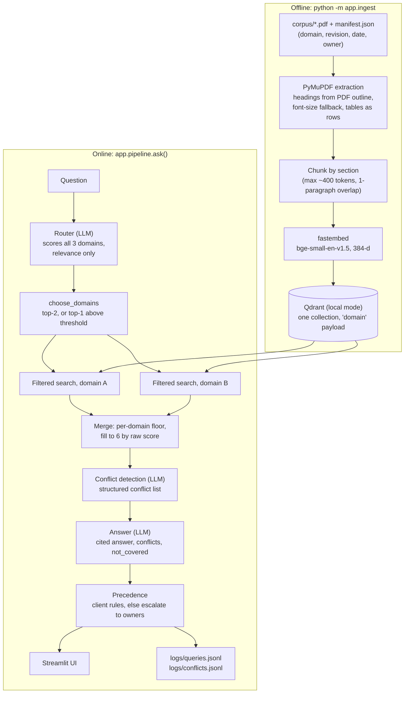

# Riverbend Floor Assistant

**The problem.** A plant's operating knowledge is spread over safety procedures,
maintenance manuals and quality specs, written by different owners and revised on
different schedules. A supervisor with a jammed conveyor or an out-of-spec reading does
not know which document to open, and when two documents disagree (one says clear small
jams in jog mode, the other says never without lockout) nobody finds out until someone is
hurt or a lot is scrapped.

**The prototype.** A question is scored against three documentation domains (safety,
maintenance, quality) by an LLM router, the two most relevant domains are searched, and a
single cited answer comes back. Where the documents contradict each other the assistant
does **not** pick a side: it shows both claims with citations and says who to escalate to.
Questions the documents do not answer are refused rather than answered from general
knowledge. Every conflict is logged, which doubles as a documentation-quality report for
the document owners. The corpus here is 12 synthetic PDFs for a fictional packaging plant
("Riverbend Packaging"), with a few deliberately planted conflicts (`corpus/PLANTED_CASES.md`).
`BUILD_PLAN.md` has the full build spec.

## Architecture



| Module | Role |
|---|---|
| `app/ingest.py` | PDF to sections to chunks to embeddings to Qdrant; idempotent (deterministic point IDs) |
| `app/router.py` | LLM scores every domain; normalized to sum to 1; few-shot examples from `eval/fewshot.jsonl` |
| `app/retrieve.py` | `choose_domains()` and filtered per-domain search with a floor merge |
| `app/generate.py` | conflict-detection pass, then the grounded answer pass; citation validation |
| `app/precedence.py` | opt-in `latest_revision` / `domain_order` rules; otherwise escalate to document owners |
| `app/pipeline.py` | `ask()` orchestration, per-stage latency, JSONL logging |
| `ui/streamlit_app.py` | route badge, conflict warnings, sources with PDF page preview, conflicts log |
| `eval/run_eval.py` | golden-set metrics and the threshold sweep |

## Run locally (no Docker)

```
make setup                      # venv + pip install
cp .env.example .env            # then set ANTHROPIC_API_KEY (and optionally APP_PASSWORD)
make corpus ingest              # build the PDFs, then the Qdrant index
make run                        # http://localhost:8501
make test
make eval
```

Without `make` (for example in plain Windows PowerShell), the same steps are:

```
python -m venv .venv && .venv\Scripts\activate    # or: source .venv/bin/activate
pip install -r requirements.txt
copy .env.example .env                            # then set ANTHROPIC_API_KEY
python scripts/build_corpus.py                    # markdown sources -> corpus/<domain>/*.pdf
python -m app.ingest --reset                      # build the Qdrant index (no API key needed)
streamlit run ui/streamlit_app.py
```

The first ingest downloads the embedding model (about 65 MB) into `./models`.
`python -m app.ingest --inspect corpus/maintenance/rp200-pump-manual.pdf` prints how a PDF
was split into sections, which is the first thing to check if retrieval looks wrong.
Embedded Qdrant allows one process at a time, so stop the app before re-ingesting.

## Run with Docker

One image runs everywhere. The PDFs, the embedding model and the Qdrant index are baked
in at build time (ingest needs no API key), so the container needs no volume and makes no
model download at runtime. At runtime it needs only `ANTHROPIC_API_KEY` and, optionally,
`APP_PASSWORD`.

```
make docker-build && make docker-run        # http://localhost:8080
docker compose up                           # same, via compose
docker compose --profile server up          # adds a Qdrant server, ingests into it,
                                            # and serves a second app against it on :8081
```

If `APP_PASSWORD` is set, the app shows a password field before anything else loads.
This is a single shared password for a public demo, not user accounts.

## Deploy to Google Cloud Run

```
PROJECT_ID=my-project REGION=us-central1 ./scripts/deploy_cloudrun.sh
python scripts/smoke_test.py https://<service-url>
```

Create the `ANTHROPIC_API_KEY` and `APP_PASSWORD` secrets in Secret Manager first (the
commands are at the top of the script); they are passed with `--set-secrets`, never as
plain env vars. The service runs with `--max-instances 1` because embedded Qdrant is
single-writer (this also caps cost) and `--min-instances 0`, so the first request after
idle pays a cold start.

To check the built image itself (makes real LLM calls):

```
docker run --rm --env-file .env riverbend-assistant python scripts/smoke_test.py --local
```

### Fallback: Streamlit Community Cloud (no Docker)

1. Push the repo to GitHub and create an app pointing at `ui/streamlit_app.py`.
2. In the app's Secrets, set `ANTHROPIC_API_KEY` and `APP_PASSWORD`.
3. On first start the UI builds `./qdrant_data` itself if it is missing (it ingests the
   PDFs under `corpus/`, which are committed or built by `scripts/build_corpus.py`).
   This downloads the embedding model, so the first start is slow.

No deployment files are provided for other hosts.

### Operational notes

- Query and conflict logs are written under `LOG_DIR`. Cloud filesystems are ephemeral,
  so these files are best-effort and the "Conflicts found" view shows only the current
  instance's history.
- The app fails fast at startup with a clear message if `ANTHROPIC_API_KEY` is missing or
  the Qdrant collection is empty.

## Tests and evaluation

```
python -m pytest -q                      # 86 unit tests; the LLM is mocked, no API key needed
python -m eval.run_eval                  # full golden-set run (make eval)
python -m eval.run_eval --skip-generation          # route + retrieve only: one LLM call per question
python -m eval.run_eval --limit 5                  # first N questions
python -m eval.run_eval --golden eval/golden.sample.jsonl --results-dir eval/results/sample
```

A full run makes about three LLM calls per question (route, conflict detection, answer).
Each question is routed **once**; that route is reused for the main run and for the
threshold sweep, which re-runs retrieval only.

Outputs go to `eval/results/` (git-ignored):

- `report.md`: overall and per-category router top-1 accuracy, top-2 domain coverage,
  retrieval recall@6 on the expected documents, conflict precision/recall, refusal recall
  and false-refusal rate, p50/p95 latency per stage, the sweep table, and a per-question
  failure list (expected vs actual).
- `threshold_sweep.png`: domain coverage and recall against the share of queries that use
  single-domain search, for `SINGLE_DOMAIN_THRESHOLD` in off / 0.6 / 0.7 / 0.8 / 0.9.

The golden set (`eval/golden.jsonl`) must not share any question with the router's
few-shot examples (`eval/fewshot.jsonl`); the harness refuses to run if it does.

## Key design decisions

- **Relevance-only routing, no safety bias.** The router scores each domain by how likely
  it is to answer the question and is told not to favour any domain. Unequal costs are
  handled where they belong: by surfacing conflicts and by client-configured precedence,
  not by skewing retrieval toward safety.
- **Two filtered searches, not one unfiltered search.** Searching each routed domain
  separately, then merging with a per-domain floor (the top 2 of each domain always make
  the cut, the rest fill by raw cosine score up to 6), guarantees the second domain is
  represented, keeps scores comparable (same model, same collection), and leaves a clear
  audit trail of which domains were searched. In practice this is what exposes
  cross-domain conflicts: the cap-torque question routes 0.87 to quality, yet the floor
  still brings in the maintenance manual that disagrees with the quality spec.
- **One generation over all chunks, preceded by a dedicated conflict check.** The model
  sees both domains together so it can notice disagreements, which is cheaper and more
  coherent than answering per domain and merging. In testing, a single call that had to
  produce both the prose answer and a structured conflict list was unreliable: it
  described a disagreement in prose but left the structured list empty in 2 of 4 runs.
  So a focused first pass (`detect_conflicts`, tuned for recall) produces the conflict
  list, and the answer pass is told about those conflicts so the prose and the structured
  field come from the same source. If the detection pass fails, the answer still returns
  and `conflict_check_ok` is false.
- **Conflicts are surfaced, never silently resolved.** Both claims are shown with
  document, section, page and revision, plus who to escalate to (the owners of the two
  documents). Precedence is a client decision: `config.PRECEDENCE_RULES` is empty by
  default. Supported opt-in rules are `latest_revision` (same document, later effective
  date wins) and `domain_order` (earlier domain in a client-supplied list wins). A
  resolved conflict is shown with the rule that resolved it.
- **Refusal over invention.** The answer pass may only use the retrieved excerpts. If they
  do not answer the question it sets `not_covered`, names the kind of document that would
  be needed, and any conflicts are discarded.
- **The conflict log is a by-product with value.** `logs/conflicts.jsonl` records every
  contradiction with both sources. It already found two inconsistencies nobody planted
  (listed in `corpus/PLANTED_CASES.md`): the RP-200 manual lets the pump keep running with
  a small seal weep while the spill procedure says to stop equipment that leaks
  sanitizer, and the PPE matrix requires a face shield for sanitizer changeover while the
  spill procedure requires one only for concentrate.
- **Threshold chosen by data.** `SINGLE_DOMAIN_THRESHOLD` (search only the top domain when
  its score is high enough) saves tokens on clear-cut questions but can miss the second
  domain. It is off by default; the eval sweep shows the coverage cost of each setting.

## Configuration

Every setting in `config.py` reads an environment variable first, so the same code runs
locally, in Docker and in the cloud.

| Variable | Default | Meaning |
|---|---|---|
| `ANTHROPIC_API_KEY` | none | required at runtime (not for ingest or the unit tests) |
| `LLM_MODEL` | `claude-sonnet-5-5` | model for routing, conflict detection and answers |
| `QDRANT_PATH` | `./qdrant_data` | embedded Qdrant directory (local mode) |
| `QDRANT_URL`, `QDRANT_API_KEY` | unset | use a Qdrant server instead of local mode |
| `FASTEMBED_CACHE` | `./models` | embedding model cache (baked into the Docker image) |
| `SINGLE_DOMAIN_THRESHOLD` | unset | e.g. `0.85`: search only the top domain at or above this score |
| `APP_PASSWORD` | unset | shared password gate for the UI; off when unset |
| `LOG_DIR` | `./logs` | where `queries.jsonl` and `conflicts.jsonl` are written |

Retrieval sizes (`K_PER_DOMAIN=5`, `FINAL_K=6`, `MIN_PER_DOMAIN=2`), chunk size and domain
owners are constants in `config.py`.

## Known limitations

- **The PDFs are synthetic and clean.** They have proper bookmarks, so section splitting
  uses the PDF outline. Real scanned manuals need OCR first, and messy layouts without an
  outline fall back to font-size heading detection (implemented and unit-tested, but not
  exercised on real documents); very irregular layouts would need a layout model.
- **Forced tool use is not available.** `claude-sonnet-5-5` rejects `tool_choice` of type
  `tool`, so the router and generator use `tool_choice: auto` plus an instruction to call
  the tool. A reply without a tool call is retried once and then raises a clear error.
  Sampling parameters such as `temperature` are not accepted either, so repeated runs on
  borderline questions can differ.
- **Conflict detection is tuned for recall.** Missing a real conflict is worse than a
  borderline flag, so expect some noise: a `scope_difference` that appears in one run and
  not the next, and several entries for one underlying disagreement (the jam-clearing
  question reports two). Conflict precision on the golden set is the number to watch.
- **Retrieval can rank the sharpest chunk low.** For the jog-mode question the safety
  "Core Rule" chunk ranks 7th within safety, below `K_PER_DOMAIN=5`. The conflict is still
  found through the neighbouring "Prohibited Practices" chunk, but this is the first place
  to look if recall drops; `K_PER_DOMAIN`/`FINAL_K` are the knobs.
- **Latency.** Roughly 2-5 s to route and 7-14 s to generate (two sequential LLM calls)
  for a question with conflicts; a refusal takes about 3 s. Retrieval is typically
  10-20 ms once warm.
- **Embedded Qdrant is single-process.** Fine for one container; use a Qdrant server for
  more than one writer or replica (`QDRANT_URL`).
- **Logs are local files.** On ephemeral cloud filesystems the conflicts view only shows
  the current instance's history.
- **Authentication is one shared password**, intended for a demo, not user accounts.

### Troubleshooting

- `TypeError: process() takes no keyword arguments`, surfacing as "Connection error" from
  the SDK: the installed `Brotli` is older than 1.2 and cannot decode the API's compressed
  responses. Run `pip install -U "brotli>=1.2"`.
- `400 ... tool_choice: type "tool" and "any" are not supported for this model`: some code
  path is forcing tool use; use `{"type": "auto"}`.
- The app starts but every answer is "Not covered": the index is empty or stale; run
  `python -m app.ingest --reset`.

## Path to production

- **Qdrant server** (or Qdrant Cloud) instead of embedded storage, via `QDRANT_URL`;
  `docker compose --profile server` already shows the shape. Payload indexes on `domain`
  and `source_path` are created and take effect in server mode.
- **Real ingestion from the client's document management system**, with OCR for scanned
  manuals, a layout model for messy PDFs, and incremental re-ingest when a revision
  changes. Point IDs are deterministic and ingest replaces a document's old chunks, so
  re-running is safe; the `revision` and `effective_date` fields are already carried on
  every chunk.
- **Access control.** Per-user or per-role domain permissions applied as Qdrant payload
  filters, replacing the shared password with SSO.
- **A feedback loop from the logs.** Capture thumbs up/down and "wrong document" signals
  next to `queries.jsonl`, and feed misroutes and bad retrievals back into the router's
  few-shot examples and the golden set.
- **Conflict report to document owners.** Turn `conflicts.jsonl` into a scheduled report
  (grouped by document pair, with the owners already recorded) so contradictions get
  fixed at the source rather than escalated again and again.
- **Client-configured precedence.** Agree rules with the client (for example, safety
  procedures outrank maintenance guides) and set `PRECEDENCE_RULES`; the escalation path
  remains for anything the rules do not cover.
- **Latency and cost.** Run conflict detection and retrieval for the second domain
  concurrently, stream the answer, cache repeated questions, and use the threshold sweep
  to decide how much single-domain search is acceptable.
- **Operations.** Persist logs to a store, alert on routing or generation failures, run
  the golden-set evaluation in CI on every change to prompts, corpus or model.
